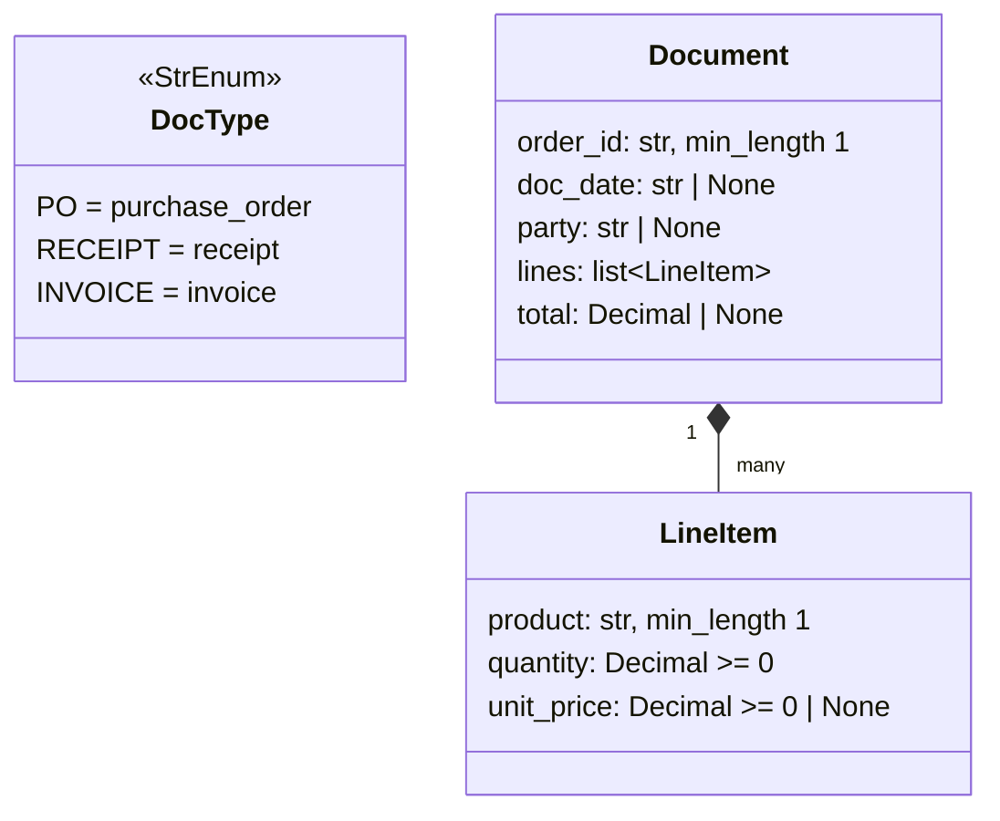

# Three-Way Match Agent: Low-Level Design

High-level design: [Three-Way Match Agent](https://devlcodes.github.io/agentic-ai-notebook/system-design/three-way-match.html). This document grows one step at a time and describes only code that exists on `main`.

## Modules

| Module | Responsibility | Added in step |
|---|---|---|
| `src/three_way_match/__init__.py` | Package marker | [00.1](steps/00.1-create-repo.md) |
| [`src/three_way_match/fetch.py`](../src/three_way_match/fetch.py) | Download source PDFs from Hugging Face, cached on disk | [01.1](steps/01.1-fetch-pdf.md) |
| [`src/three_way_match/render.py`](../src/three_way_match/render.py) | Render PDF pages to PNG within the parser's size limit | [01.2](steps/01.2-render-pages.md) |
| [`src/three_way_match/parse.py`](../src/three_way_match/parse.py) | Read a page image with Nemotron 3.5 Parse | [01.3](steps/01.3-parse-page.md) |
| [`src/three_way_match/clean.py`](../src/three_way_match/clean.py) | Strip layout tags from parsed text | [01.4](steps/01.4-clean-text.md) |
| [`src/three_way_match/schemas.py`](../src/three_way_match/schemas.py) | Pydantic models for extracted documents | [01.5](steps/01.5-data-models.md) |
| [`src/three_way_match/extract.py`](../src/three_way_match/extract.py) | LLM extraction of a `Document` with one validation retry | [01.6](steps/01.6-llm-extraction.md) |
| [`src/three_way_match/read.py`](../src/three_way_match/read.py) | Reading pipeline for one document or a whole order | [01.7](steps/01.7-read-order.md) |
| [`src/three_way_match/crosscheck.py`](../src/three_way_match/crosscheck.py) | Compare parsed text with the PDF text layer | [01.8](steps/01.8-crosscheck.md) |

## Data model

Pydantic models in [`schemas.py`](../src/three_way_match/schemas.py), added in [01.5](steps/01.5-data-models.md). `LineItem` and `Document` set `extra="forbid"`. Money is `Decimal`, never `float`.



## Document reading pipeline

```python
def fetch_pdf(kind: str, order_id: str, client: httpx.Client | None = None, pdf_dir: Path = Path("data/pdfs")) -> Path | None
def render(pdf_path: Path, out_dir: Path = Path("data/pages")) -> list[Path]
def parse_page(image: Path, cache_dir: Path = Path("data/parsed"), client: httpx.Client | None = None) -> str
def clean(content: str) -> str
def chat(messages: list[dict[str, str]]) -> str
def json_object(reply: str) -> str
def extract(text: str, doc_type: DocType, attempts: int = 2, chat: Chat = chat) -> Document
def read_document(doc_type: DocType, order_id: str, log: Log = _quiet, cache_dir: Path = Path("data/extracted")) -> Document | None
def read_order(order_id: str, log: Log = _quiet) -> dict[DocType, Document | None]
def text_layer(pdf_path: Path) -> str
def missing_amounts(pdf_path: Path, parsed_text: str) -> list[Decimal] | None
```

| Step | Detail | Cache |
|---|---|---|
| Fetch ([01.1](steps/01.1-fetch-pdf.md)) | `GET https://huggingface.co/datasets/AyoubChLin/<repo>/resolve/main/<file>`, redirects followed, 60 s timeout. `kind` is `purchase_order` (`northwind_PurchaseOrders`, `purchase_orders_<id>.pdf`), `receipt` (`northwind_Shipping_orders`, `order_<id>.pdf`) or `invoice` (`northwind_invocies`, `invoice_<id>.pdf`). `404` returns `None`; other errors raise | `data/pdfs/`, checked before any request |
| Render ([01.2](steps/01.2-render-pages.md)) | pypdfium2; scale = min(1664 / width, 2048 / height) with page size in points; RGB PNG; `thumbnail((1664, 2048))` corrects pdfium's round-up overshoot. Output `<stem>_p<n>.png` | `data/pages/`, per page |
| Parse ([01.3](steps/01.3-parse-page.md)) | `POST https://ai.api.nvidia.com/v1/retrieval/nvidia/nemotron-3.5-parse/parse`, multipart parts `document` (PNG) and `options` (`{"decoding":{"max_output_tokens":4096}}`), `Authorization: Bearer $NVIDIA_API_KEY`, 120 s timeout. Returns JSON `content`: one paragraph per block, `<x_..><y_..>` box corners as page fractions, `<class_..>` block type, Markdown bold, LaTeX `tabular` for tables | `data/parsed/<stem>.txt`, per page |
| Clean ([01.4](steps/01.4-clean-text.md)) | Split on `\n\n`; drop blocks containing `<class_Picture>`; remove `<x_[\d.]+>`, `<y_[\d.]+>`, `<class_[\w-]+>`; strip. Keeps Markdown bold and LaTeX tables. Invoice 10250: 783 → 470 characters | None (cheap) |
| Extract ([01.6](steps/01.6-llm-extraction.md)) | `POST https://integrate.api.nvidia.com/v1/chat/completions`, model `EXTRACT_MODEL` (default `nvidia/nemotron-3.5-lightning-30b-a3b`), temperature 0, `max_tokens` 8192 (includes reasoning), 300 s timeout. Prompt puts the text inside `<document>` tags and says it is data. Reply cut to outermost `{...}`, validated with `Document.model_validate_json`. On `ValidationError`: append reply (assistant) and error (user), retry once; second failure raises. `chat` is injectable for tests. Invoice 10250: 32.7 s | Final `Document` cached by `read_document` |
| Read ([01.7](steps/01.7-read-order.md)) | `fetch_pdf` → `None` stops; cache hit on `data/extracted/<pdf stem>.json` skips the rest; else `render`, `clean(parse_page(p))` per page, pages joined with `\n\n` before one `extract`. `read_order` runs all three `DocType`s. Order 10250 cold: 72 s; warm: 0.15 s | `data/extracted/` (delete after prompt or model changes) |
| Cross-check ([01.8](steps/01.8-crosscheck.md)) | pdfium text layer, all pages. Amounts: `\$?\s?(\d[\d,]*\.\d+)` in the text layer vs every number `\d[\d,]*(?:\.\d+)?` in the parsed text, compared as `Decimal`. Returns missing amounts in page order; `None` when there is no text layer (scans). Not yet called by `read_order`: becomes a signal in the workflow (Phase 5). Invoice 11077: `[Decimal('1374.60')]` | None |

## Matching rules

## Workflow state machine

## Job queue and worker

## HTTP API

## Telemetry

## Deployment
