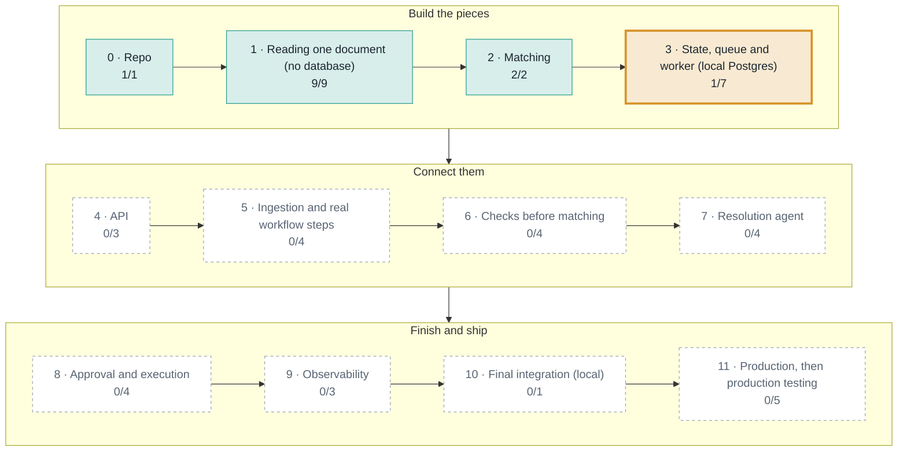

# Build progress

**13 of 47 steps done.** Next: **03.2 Migrations: `cases`, `case_events`, append-only trigger**.

Generated by `scripts/progress.py` from the [build plan](superpowers/specs/2026-11-05-three-way-match-rebuild-design.md) and the records in [steps/](steps/). Green is done, orange is in progress, dashed is not started.

## Phases

## What exists in the system so far

```mermaid
flowchart LR
  pdfs["Source PDFs<br/>Hugging Face"]:::done
  read["Read<br/>fetch · render · parse<br/>clean · extract"]:::done
  xcheck["Cross-check<br/>PDF text layer"]:::done
  match["Rule matcher"]:::done
  state["State machine<br/>+ Postgres"]:::next
  queue["Job queue<br/>+ worker"]:::next
  api["API + webhooks"]:::todo
  ingest["Ingestion<br/>replay · reconcile"]:::todo
  checks["Duplicate · fraud<br/>injection checks"]:::todo
  agent["Resolution agent"]:::todo
  approve["Human approval"]:::todo
  exec["Executor<br/>erp_postings"]:::todo
  %% obs in platform
  %% cloud in platform
  subgraph platform["Around everything"]
    direction TB
    obs["Traces · logs · alerts"]:::todo
    cloud["Cloud Run + Supabase"]:::todo
  end
  ingest --> api
  api --> queue
  queue --> state
  pdfs --> read
  pdfs --> xcheck
  state --> read
  read --> checks
  checks --> match
  xcheck --> match
  match -- clean --> approve
  match -- exception --> agent
  agent --> approve
  approve --> exec
  classDef done fill:#d8eeea,stroke:#2a9d8f,color:#1c2530
  classDef next fill:#f8ead2,stroke:#d7932a,stroke-width:3px,color:#1c2530
  classDef todo fill:#ffffff,stroke:#9aa5b1,stroke-dasharray:4 4,color:#586473
```

## Steps

### Phase 0: Repo

| Step | What | Status |
|---|---|---|
| 00.1 | Create the public repo, uv project, pytest, this design doc | done · [record](steps/00.1-create-repo.md) |

### Phase 1: Reading one document (no database)

| Step | What | Status |
|---|---|---|
| 01.1 | Fetch one invoice PDF from the Hugging Face Northwind dataset | done · [record](steps/01.1-fetch-pdf.md) |
| 01.2 | Render PDF pages to PNG | done · [record](steps/01.2-render-pages.md) |
| 01.3 | Parse one page with Nemotron 3.5 Parse | done · [record](steps/01.3-parse-page.md) |
| 01.4 | Clean the parsed text | done · [record](steps/01.4-clean-text.md) |
| 01.5 | Define the data models | done · [record](steps/01.5-data-models.md) |
| 01.6 | Extract a `Document` with the LLM, with a retry on invalid JSON | done · [record](steps/01.6-llm-extraction.md) |
| 01.7 | Read all three documents for an order | done · [record](steps/01.7-read-order.md) |
| 01.8 | Cross-check parsed values against the PDF text layer | done · [record](steps/01.8-crosscheck.md) |
| 01.9 | Extraction completeness check (added after step 2.2 found PO 11077 losing page 2's lines) | done · [record](steps/01.9-extraction-completeness.md) |

### Phase 2: Matching

| Step | What | Status |
|---|---|---|
| 02.1 | Rule matcher on a clean order | done · [record](steps/02.1-match-clean.md) |
| 02.2 | Every exception code | done · [record](steps/02.2-exception-codes.md) |

### Phase 3: State, queue and worker (local Postgres)

| Step | What | Status |
|---|---|---|
| 03.1 | Local Supabase Postgres in Docker Compose | done · [record](steps/03.1-local-supabase.md) |
| 03.2 | Migrations: `cases`, `case_events`, append-only trigger | **next** |
| 03.3 | State machine: `create_case`, `advance` | not started |
| 03.4 | pgmq queue | not started |
| 03.5 | Worker drain with idempotent handling | not started |
| 03.6 | Retries and dead-letter queue | not started |
| 03.7 | Timers and `WAITING_DOCS` | not started |

### Phase 4: API

| Step | What | Status |
|---|---|---|
| 04.1 | FastAPI health check and token auth | not started |
| 04.2 | Case list and timeline endpoints | not started |
| 04.3 | Signed webhook ingest | not started |

### Phase 5: Ingestion and real workflow steps

| Step | What | Status |
|---|---|---|
| 05.1 | `DocumentSource` interface with the Hugging Face implementation | not started |
| 05.2 | Replay script sending webhooks, including late, twice and out of order | not started |
| 05.3 | Reconcile job | not started |
| 05.4 | Real steps replace stand-ins: read, extract, match inside the workflow | not started |

### Phase 6: Checks before matching

| Step | What | Status |
|---|---|---|
| 06.1 | Seed vendors and labelled fake and duplicate invoices | not started |
| 06.2 | Duplicate checks | not started |
| 06.3 | Fraud signals | not started |
| 06.4 | Prompt-injection screening | not started |

### Phase 7: Resolution agent

| Step | What | Status |
|---|---|---|
| 07.1 | One tool call through LangGraph on the NVIDIA model | not started |
| 07.2 | The read-only tools, one at a time | not started |
| 07.3 | The agent loop with limits, `Proposal` and evidence check | not started |
| 07.4 | Memory: embeddings and similar past cases | not started |

### Phase 8: Approval and execution

| Step | What | Status |
|---|---|---|
| 08.1 | Review UI: case list and case page | not started |
| 08.2 | Approval with action hash, sign-in and amount limits | not started |
| 08.3 | Outbox and executor | not started |
| 08.4 | Escalation, rejection and failure paths | not started |

### Phase 9: Observability

| Step | What | Status |
|---|---|---|
| 09.1 | One trace per case | not started |
| 09.2 | Structured logs, metric views and an ops page | not started |
| 09.3 | Alerts | not started |

### Phase 10: Final integration (local)

| Step | What | Status |
|---|---|---|
| 10.1 | Run a batch of orders end to end through every path | not started |

### Phase 11: Production, then production testing

| Step | What | Status |
|---|---|---|
| 11.1 | Accounts: Google Cloud project and `gcloud`, staging and production Supabase projects, Langfuse project | not started |
| 11.2 | Deploy to Cloud Run with migrations, secrets and the drain cron | not started |
| 11.3 | Cloud smoke test | not started |
| 11.4 | Evals in CI with release gates | not started |
| 11.5 | Production tests: load run, failure drills, injection suite | not started |
