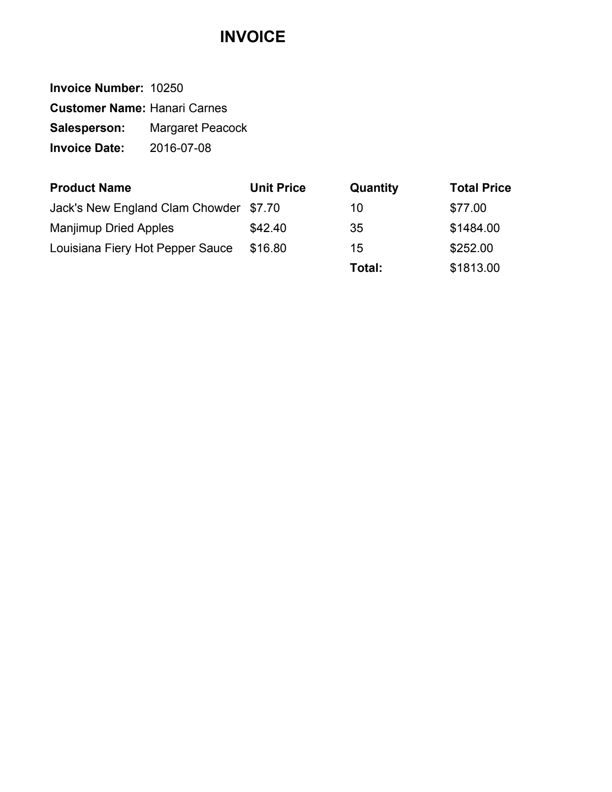

# Step 01.2: Render PDF pages to images

**Goal:** turn each page of a PDF into a PNG image sized for the parser, because Nemotron Parse reads page images, not PDFs.

## Files

| File | What it is |
|---|---|
| [`src/three_way_match/render.py`](../../src/three_way_match/render.py) | `render(pdf_path, out_dir)` and a command-line entry point that prints sizes |
| [`tests/test_render.py`](../../tests/test_render.py) | Builds blank PDFs in memory and checks file names, size limits and caching |
| [`pyproject.toml`](../../pyproject.toml) | Adds `pypdfium2` (Google's PDF engine, the one in Chrome) and `pillow` (images) |

## Commands and output

First test run, which found a bug:

```
$ uv run pytest -q
FAILED tests/test_render.py::test_one_png_per_page_within_size_limit - assert...
1 failed, 3 passed in 0.11s

E               assert (1665 <= 1664)
```

After the fix:

```
$ uv run python -m three_way_match.render data/pdfs/invoice_10250.pdf
data/pdfs/invoice_10250.pdf: 1 page(s)
  page 1: 612 x 792 pt, scale 2.59 -> data/pages/invoice_10250_p1.png 1583 x 2048 px

$ uv run pytest -q
4 passed in 0.13s
```

The rendered page:



## What happened

1. pypdfium2 opened the PDF: 1 page, 612 × 792 points. A point is 1/72 inch, so that's US Letter (8.5 × 11 in).
2. The parser accepts images up to 1664 × 2048 px. The scale is the largest that fits both sides: min(1664/612, 2048/792) = min(2.72, 2.59) = 2.59. Height is the tighter side.
3. The page was drawn at 2.59× to 1583 × 2048 px and saved as `data/pages/invoice_10250_p1.png`. Scaling up matters: small text drawn at 72 dpi would be too blurry for the parser to read reliably.
4. A second run reuses the saved PNG, like the PDF cache in step 01.1.

**The bug the test found:** for a landscape page (792 × 612 pt) the scale is 1664/792 = 2.1010…, and 612 × 2.1010 = 1285.8. pdfium rounds pixel sizes *up*, and the width came out 1665 px: one over the limit. The fix shrinks any image that lands over the limit back inside it (`image.thumbnail`). The old repo has the same bug; it never showed there because Northwind pages are portrait.

**Why it matters next:** step 01.3 sends this image to Nemotron Parse and gets back the text it reads.

Code: [`render.py`](../../src/three_way_match/render.py) · LLD: [Document reading pipeline](../LLD.md#document-reading-pipeline)
